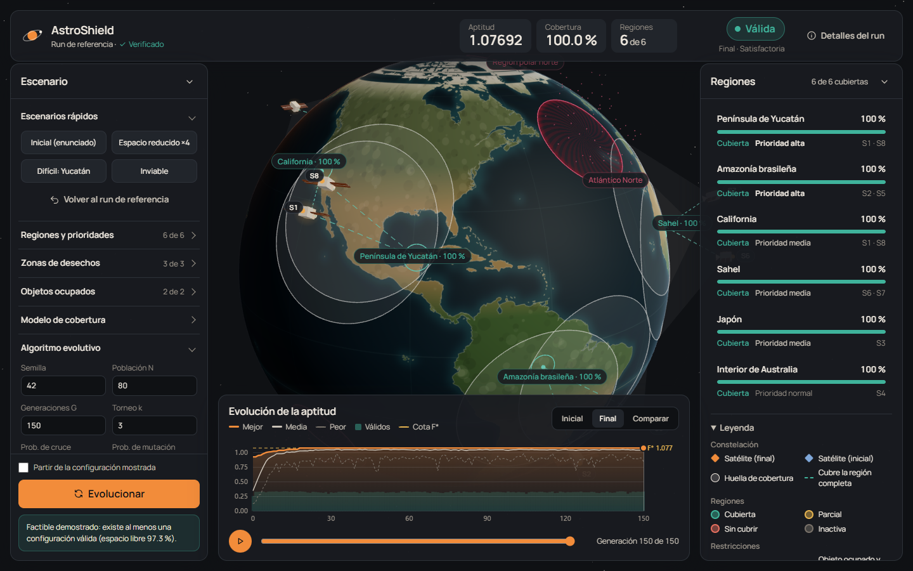
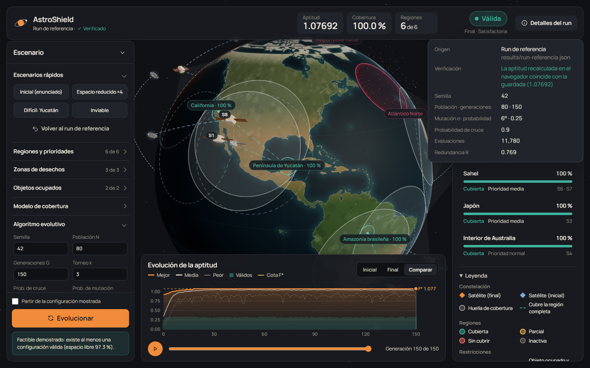
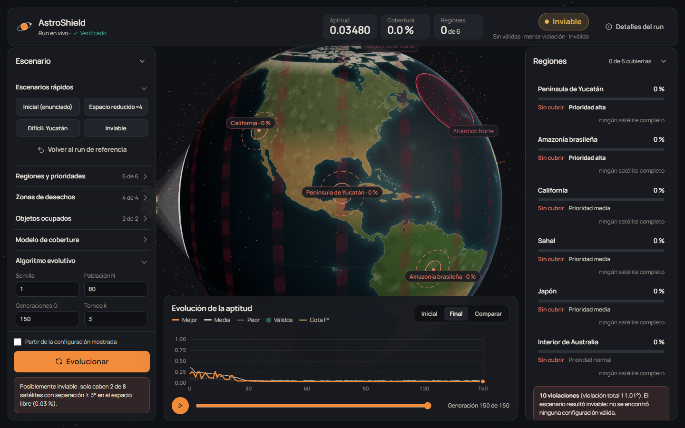
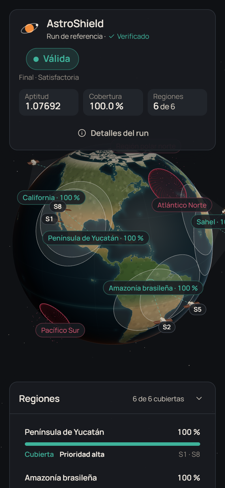

# Entregable 5 — Visualización 3D

## Cómo abrirla

```bash
npm install
npm run dev
```

Abre la dirección que imprime Vite (por defecto http://localhost:5173).

## Qué datos muestra (y de dónde salen)

**La visualización no inventa nada.** Al abrirse carga `results/run-referencia.json`, la ejecución real con semilla 42 que genera `npm run experimentos`. Al instante:

1. **Vuelve a evaluar** la configuración final con el mismo código del núcleo (`evaluarEn`) y lo indica bajo el título con *«Verificado»*; el texto completo (*«La aptitud recalculada en el navegador coincide con la guardada (1.07692)»*) está en **Detalles del run**. Si los números no coincidieran, aparecería *«No coincide»* en coral.
2. Dibuja cada satélite en la latitud y longitud exactas de la configuración.
3. Colorea cada región según la evaluación del núcleo (cubierta / parcial / no cubierta).

Cuando se pulsa **Evolucionar**, el algoritmo corre en un **Web Worker** con el mismo `MotorEvolutivo` que usan la CLI y las pruebas. Con la misma semilla y el mismo escenario el resultado es idéntico. Por ejemplo, el preset «Inviable» termina con violación 11.01°, igual que la prueba P6.

La prueba automática `tests/referencia.test.ts` vuelve a ejecutar la semilla 42 y comprueba que el resultado sea idéntico al archivo que carga la UI.

Cada escenario rápido fija las condiciones **y la semilla** de una ejecución documentada en docs/03 ([presets.ts](../src/app/presets.ts)): «Inicial» = P1 (semilla 42), «Espacio reducido ×4» = P5 con factor 4 (semilla 1), «Difícil: Yucatán» = P6 (a) (semilla 1) e «Inviable» = P6 (b) (semilla 1). Lo comprueba `tests/presets.test.ts`.

`tests/coordenadas.test.ts` comprueba que lo dibujado corresponde a los datos: la conversión lat/lon → 3D de la escena es la misma del núcleo, cada satélite del run de referencia queda en su coordenada exacta, la textura del globo coincide con esa conversión (las costas están donde dicen sus coordenadas) y las huellas y zonas se dibujan con el radio angular del modelo.

## Qué distingue (requisitos del enunciado)

| Requisito | Cómo se ve |
|---|---|
| La Tierra | Globo con costas reales (Natural Earth 1:50 m) dibujadas con un estilo propio: océano con plataforma continental, tierra coloreada por franjas de latitud (hielo, templada, árida, tropical) con relieve suave, retícula discreta cada 30°, luz lateral con terminador visible y atmósfera que pasa de azul a cálido según la luz |
| Regiones a observar | Disco de 300 km a escala real, punto central, etiqueta con el % observado |
| Los 8 satélites | Modelo 3D propio (cuerpo, paneles, antena) en metal claro con baliza ámbar, halo discreto y etiqueta S1…S8 |
| Huella de cobertura | Círculo de 20° sobre la superficie como luz color hueso, con cono de visión desde el satélite |
| Regiones cubiertas / no cubiertas | Verde agua = cubierta, miel = parcial, coral = sin cubrir. Las parciales y sin cubrir llevan además un anillo discontinuo fijo, así el estado no depende solo del color. Rayos verde agua punteados desde cada satélite que cubre la región completa |
| Zonas de desechos | Casquete con tramado diagonal color frambuesa, borde marcado y desechos flotando lentamente |
| Objetos ocupados | Octaedro lavanda a la altura de los satélites, anillo de exclusión y círculo discontinuo de exclusión en la superficie |
| Girar el globo | Arrastrar con el ratón o el dedo y rueda para zoom. La rotación automática se detiene al interactuar |
| Inicial contra final | Botones **Inicial / Final / Comparar**. En *Comparar*, los satélites iniciales aparecen en azul pizarra con un arco punteado hasta su posición final |

## Interfaz (HUD)

- **Barra superior:** origen del run y verificación, los tres indicadores principales (aptitud F, cobertura y regiones cubiertas) y el chip **Válida / Inválida / Inviable** con su contexto y nivel (Aceptable / Satisfactoria). El botón **Detalles del run** muestra semilla, población y generaciones, mutación, cruce, evaluaciones, redundancia y el archivo de origen.
- **Panel izquierdo (Escenario):** secciones plegables con los presets de escenario (inicial, espacio reducido, difícil, inviable), regiones con prioridad y activación, zonas de desechos y objetos (activar, mover, cambiar radio, agregar y borrar), parámetros del modelo y del algoritmo. El arranque en caliente y el botón **Evolucionar** quedan siempre visibles al pie. Al editar las condiciones se muestra el análisis de factibilidad.
- **Panel derecho (Regiones):** cada región con su % observado, barra de cobertura, estado escrito (*Cubierta / Parcial / Sin cubrir*), prioridad y los satélites que la cubren completa; un clic hace volar la cámara a la región. Debajo, la leyenda agrupada (constelación, regiones, restricciones).
- Ambos paneles laterales se pueden **plegar** para ver el globo completo; el globo se recentra en el espacio libre.
- **Dock inferior:** gráfica propia en canvas (mejor con área, media, peor, válidos y cota F* rotulada), con guía al pasar el cursor, tooltip y clic para saltar a una generación. Línea de tiempo con reproducción para ver la mejor configuración de cada generación.
- **Clic en un satélite:** tarjeta con coordenadas, regiones que cubre, margen a la restricción más cercana y violaciones. `Esc` cierra la tarjeta y los detalles.

## Cambio de condiciones en la interfaz (sección 3.3)

Al cambiar cualquier condición (apagar una zona, moverla, cambiar una prioridad o agregar una zona), la configuración mostrada se **reevalúa al instante** con el núcleo:

- el chip pasa a **Inválida** si ahora viola algo, y la lista de regiones y los colores se actualizan;
- un aviso explica: *"Condiciones modificadas… Reevaluada ahora: INVÁLIDA"*, con la lista de qué satélite invade qué zona (o qué par de satélites está demasiado cerca) y por cuántos grados;
- **Evolucionar** adapta la constelación. Con *arranque en caliente*, la configuración anterior entra a la población inicial.

## Garantía: nunca se muestra una inválida como válida

El chip lo decide `estadoParaMostrar()` ([estadoVista.ts](../src/app/estadoVista.ts)) a partir de la evaluación del núcleo **en las condiciones actuales**. La prueba `tests/estadoVista.test.ts` evalúa 400 configuraciones aleatorias en todos los contextos posibles y verifica que ninguna inválida produzca el chip VÁLIDA.

## Las animaciones son decorativas

- Las transiciones entre configuraciones interpolan por gran círculo **solo durante la animación**. Al terminar, cada satélite queda en la coordenada exacta del modelo (`capas.ts`, comentario en `actualizar`).
- La altitud visual de los satélites (1.24 radios terrestres) es decorativa: el modelo no usa altitud (supuesto S2).
- Solo hay movimiento cuando algo cambia: la transición entre configuraciones, una onda suave cuando cada huella llega a su sitio y otra cuando una región cambia de estado. No hay pulsos ni parpadeos continuos; lo único constante es la rotación automática (que se detiene al tocar el globo) y la deriva lenta de los desechos.
- En la interfaz: los paneles aparecen escalonados al cargar, el chip «late» una vez cuando cambia de estado y los botones, interruptores y secciones responden al pasar el cursor o al pulsar.
- Con `prefers-reduced-motion` no hay rotación automática, ondas, partículas en movimiento, estelas, vuelos ni animaciones de interfaz: todo cambia al instante. La preferencia se respeta aunque cambie con la página abierta.
- Sin WebGL se muestra un mensaje y el HUD sigue mostrando los datos (tabla, gráfica, métricas).

## Diseño y personalización



Dirección visual **«control de misión cálido»**: superficies carbón cálido, texto color hueso, tipografía Manrope (IBM Plex Mono solo para coordenadas) y un único acento color sol para lo que se puede tocar. La idea es que se lea como un panel de trabajo humano y tranquilo, no como una consola de neón.

Todos los colores, las fuentes y las duraciones de las animaciones están en un solo archivo: [`src/app/tema.ts`](../src/app/tema.ts). La escena 3D y la gráfica los leen directamente y el CSS los recibe como variables (`--acento`, `--s-regionCubierta`, `--fuente-ui`, `--dur-media`, …). `estilos.css` no tiene ningún color ni fuente escritos a mano.

**Un color, un significado** (`semantica` en tema.ts):

| Significado | Color |
|---|---|
| Satélites, botones y selección | Sol `#f28c3a` (baliza y acento) y hueso `#f3ece2` (cuerpo y huella) |
| Región cubierta, rayo de cobertura, chip Válida | Verde agua `#3fb39b` |
| Región parcial, cota F*, chip Inviable | Miel `#e6b450` |
| Región sin cubrir, chip Inválida | Coral `#e8705f` |
| Zona de desechos | Frambuesa `#c4506a` |
| Objeto ocupado | Lavanda `#a99be0` |
| Satélite de la configuración inicial | Azul pizarra `#7fa7d9` |
| Inactivo, peor aptitud | Gris cálido `#7a736a` |

La prioridad de las regiones **no** usa color (en la versión anterior el rojo significaba a la vez «prioridad alta», «no cubierta», «desechos» y «peor»): se distingue por el peso del texto.

| Comparar inicial contra final | Escenario inviable | Teléfono |
|---|---|---|
|  |  |  |

## Rendimiento

No hay posprocesado (antes se usaba bloom) y los discos transparentes de doble cara se dibujan en una sola pasada. Medido forzando 60 cuadros a 1280×800 con sincronización de GPU: unos 7.7 ms por cuadro, de los cuales unos 6.7 ms son el costo fijo de la propia medición.
